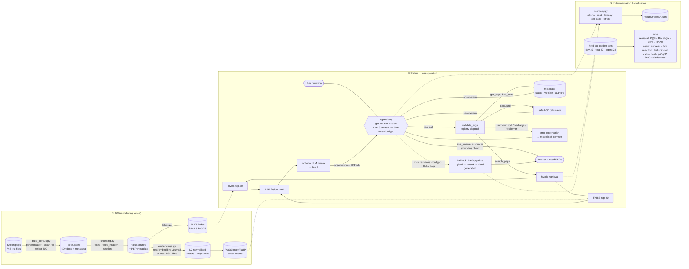

# Architecture — data flow

PEP Copilot answers questions about an internal knowledge base of **500 Python Enhancement
Proposals**. Two paths share the same retrieval stack: a plain **RAG pipeline** and a
**multi-step agent** that selects tools and falls back to RAG when it fails.

## Components

| Layer | Module | Responsibility |
|---|---|---|
| Data | `scripts/build_corpus.py`, `corpus.py` | Clone python/peps, parse RFC-822 headers, clean RST, deterministic 500-doc selection |
| Chunking | `chunking.py` | 3 strategies (fixed 200/50, fixed + contextual header, section-aware) |
| Embedding | `embeddings.py` | `text-embedding-3-small` (prod, cached on disk) / TF-IDF+SVD (offline baseline) |
| Retrieval | `retrieval.py`, `rerank.py` | BM25 ‖ FAISS → RRF → LLM rerank (falls back to RRF order on failure) |
| Generation | `generate.py`, `pipeline.py` | Cited answers `[n]`, explicit "not found", Rejected/Superseded warning |
| Agent | `agent/tools.py`, `agent/loop.py`, `agent/graph.py` | 5 tools, schema validation, failure handling F1–F9, LangGraph port |
| LLM access | `llm.py` | OpenAI SDK client (OpenAI or OpenRouter), exponential backoff, JSON mode + Pydantic repair loop |
| Instrumentation | `telemetry.py` | Every LLM/embed/tool/retrieval event: tokens, $, latency, ok/error, run id |
| Evaluation | `eval/*` | Retrieval scorecard (dev/test), agent vs RAG scorecard, faithfulness |

## Failure handling (agent)

| # | Failure | Detection | Response |
|---|---|---|---|
| F1 | Hallucinated tool name | name ∉ registry | Error observation listing real tools |
| F2 | Invalid arguments | JSON-schema validation | Error observation with the reason |
| F3 | Tool raises | `try/except` in dispatch | Error observation, loop continues |
| F4 | Empty result | 0 hits / unknown PEP | Observation suggesting a reformulation |
| F5 | Loop | same (tool, args) > 2 times | Nudge, call not re-executed |
| F6 | Ungrounded answer | `sources` ∉ PEPs observed | final_answer rejected once |
| F7 | Max iterations / token budget | counters | Fallback to RAG pipeline |
| F8 | LLM outage | `LLMError` after 5 retries (2,4,8,16 s) | Fallback to RAG, else explicit error |
| F9 | Soft stop | answer without `final_answer` | Accepted, flagged `text` |

Every row is covered by a deterministic test in `tests/test_agent_failures.py` (scripted fake LLM).
